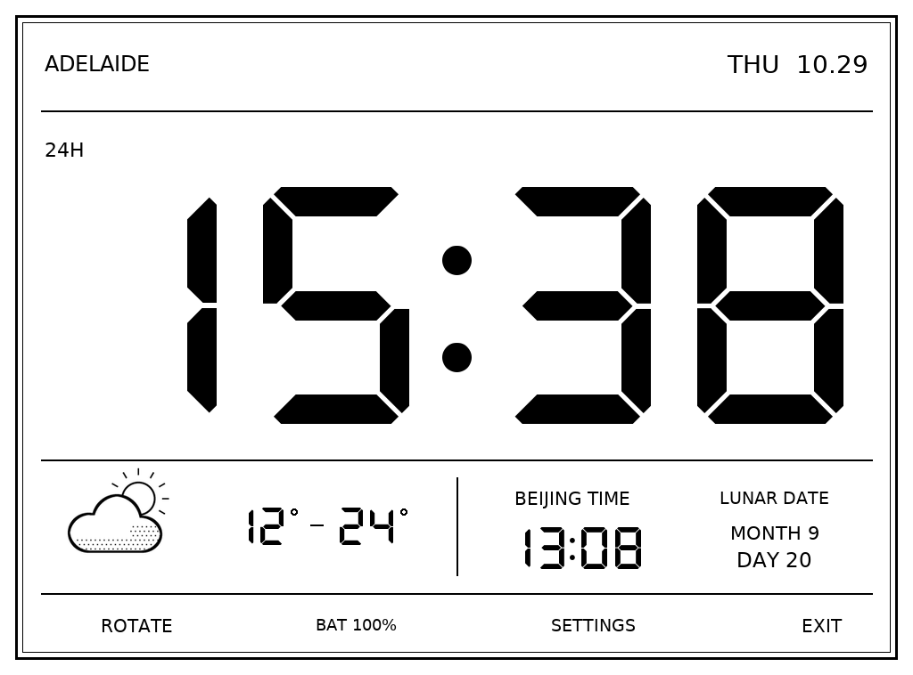
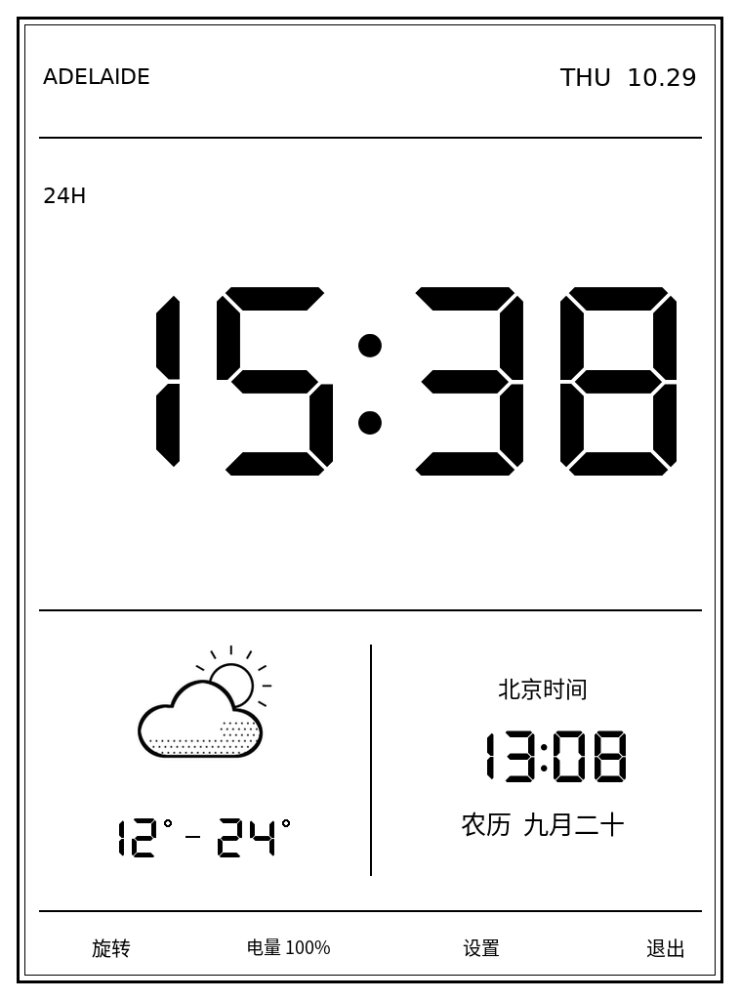
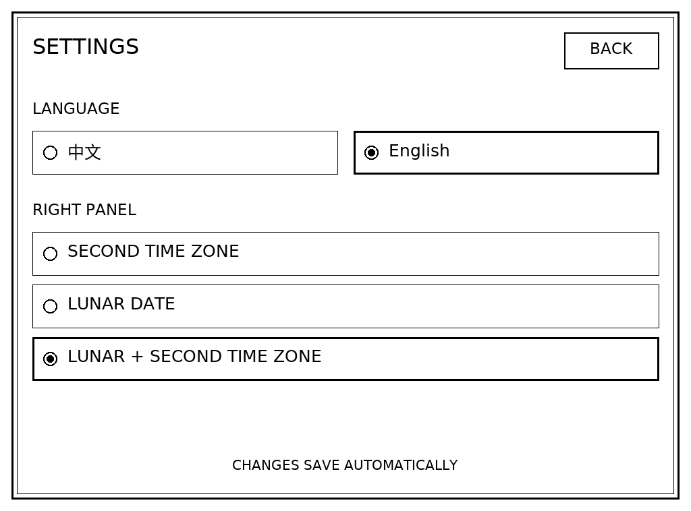

# Kindle Clock

[English](README.en.md) · [设备适配](docs/PORTING.md) · [第三方许可](NOTICE.md)

一个把旧 Kindle 用作桌面时钟的小项目：大字电子表、天气图标、当日最低／最高温，以及可选的第二时区和农历。

这个项目最初是为一台 **Kindle Paperwhite 2（2013 / 第 6 代），固件 5.12.2.2** 制作的个人工具。现在把源码和设计分享出来，欢迎大家在这个基础上，根据自己的设备、城市和使用习惯调整，也欢迎反馈适配结果或提交 PR。

**这是面向爱好者的早期版本，不是已经验证全系列兼容的一键安装包。**

## AI 辅助越狱、逆向分析与开发

这个项目是在 **AI（Codex）协作**下完成的旧设备改造实践。除了界面设计和程序开发，过程还包括核对社区公开的越狱方案、阅读开源启动器、分析安装包结构与运行依赖，以及排查显示、触摸、天气联网和退出恢复的问题。

这里的“AI 辅助破解／逆向”指的是利用 AI 协助理解已有方案、工具行为和文件格式，并在具体设备上做适配与验证。越狱使用社区已有的 [WinterBreak](https://github.com/KindleModding/WinterBreak) 方案；包格式分析参考 [KindleTool](https://github.com/NiLuJe/KindleTool)，桌面恢复方式参考 KOReader。本项目没有声称发现新的越狱漏洞，也不发布通用破解工具。

我们希望这份源码能展示一种实践方式：让 AI 帮助理解旧设备和开源工具，再通过实际检查逐步完成改造。欢迎大家在这个基础上继续分析、修改和适配自己的设备，同时清楚标注哪些结果已经实测。

## 当前验证情况

| 内容 | 状态 |
| --- | --- |
| PW2 上的全屏显示、时间、天气联网检查和正常退出 | 前一版已实机验证 |
| 新版中英文设置、三种右侧显示模式、配置保存和触摸流程 | 已通过桌面模拟测试，尚未实机验证 |
| 其他 Kindle 型号、分辨率、固件 | 未验证，欢迎适配 |

最新版的设置功能没有继续写入原设备测试，因此请不要把模拟截图理解为所有功能都已实机确认。

## 界面

以下为程序渲染的示例图，时间和天气为演示数据。



<p align="center"></p>

## 功能

- 紧凑的七段式大字时钟，支持横屏／竖屏。
- 黑白天气图标与点状云层阴影；月亮只保留轮廓。
- 当天最低温至最高温，不显示逐小时预报。
- **中文 / English** 界面切换，设置自动保存在设备上。
- 右侧内容三选一：**第二时区、农历、农历＋第二时区**。单项整体居中；双项横屏左右、竖屏上下排列。
- 运行时防止自动待机，退出后恢复先前设置。
- 通过书库中的 **Adelaide Clock** 封面启动。



## 时间与天气

时钟读取 **Kindle 本机系统时间**，不需要联网取时。默认主时区为 `Australia/Adelaide`，包含夏令时；第二时区为北京时间 `UTC+08:00`。农历使用北京时间对应的日期，在本机计算，支持库的日期范围为 1900–2099。

天气使用 [Open-Meteo](https://open-meteo.com/)，约每 15 分钟刷新。每天的最低／最高温按 Adelaide 当地日期选择，单位为摄氏度。断网时显示离线提示；缓存没有对应日期的数据时显示缺省值，不把昨天的预报当成今天。

**目前城市与时区仍采用 Adelaide＋北京时间的示例配置。** 设置页只提供语言和右侧显示模式，不提供城市搜索或任意时区选择。改变位置需要调整 `clock.py` 的接口坐标、时区及标签，见[适配说明](docs/PORTING.md)。

## 运行条件

- 已完成越狱、支持从书库运行 `.sh` 的 Kindle；本项目不包含越狱或固件工具。
- 适合对应设备的 Python 3.9+ 和 Pillow。原设备使用 NiLuJe Python3 0.15.N 的 PW2+ 运行环境，Python 3.9.8 / Pillow 9.0.0.dev0。
- 运行环境的默认位置为 `/mnt/us/python3/bin/python3.9`。
- 系统提供 `eips`、`lipc-get-prop`、`lipc-set-prop`、`initctl`、`setsid` 等原生工具。

Python 运行环境需要自行准备。本仓库不捆绑原设备的系统、运行环境安装包或用户数据。NiLuJe 的原始工具发布说明见 [MobileRead](https://www.mobileread.com/forums/showthread.php?t=225030)。

## 手动安装（仅针对已匹配上述条件的设备）

1. 将 `extensions/adelaide-clock/` 复制到 Kindle 的同名目录。
2. 将 `documents/Adelaide-Clock.sh` 复制到 Kindle 的 `documents/`。
3. 确认 `launch.sh` 中的 Python 路径适合自己的环境。
4. 安全弹出设备，打开书库中的 **Adelaide Clock**。天气需要 Wi-Fi。

底部按钮为 **旋转 / ROTATE**、电量、**设置 / SETTINGS**、**退出 / EXIT**。设置页选择后自动保存，按 **返回 / BACK** 回到时钟。`settings.json` 是运行时生成的个人设置文件，不在仓库内。

不要在未核对设备差异时直接套用：当前代码仍包含 PW2 的屏幕尺寸、触摸坐标、设备路径和桌面服务处理方式。更换机型时请先阅读[适配说明](docs/PORTING.md)。

## 开发与测试

在支持 `fcntl` 的 Python 3.9+ 环境中（如 Linux/macOS）：

```sh
python3 -m pip install -r requirements-dev.txt
python3 -m unittest discover -s tests -v
```

桌面测试不操作真实 Kindle。它们不能替代实机对触摸、刷屏、耗电和退出恢复的验证。

## 欢迎一起改进

欢迎 fork 后按自己的设备修改。反馈时可以提供机型、固件、运行环境版本、复现步骤和不含隐私的截图。不要上传完整设备备份、个人书籍、账号资料或未检查过的日志。

原始代码和新增自绘图标使用 GPL-3.0；第三方代码、字体和证书保留各自许可，详见 [LICENSE](LICENSE) 和 [NOTICE.md](NOTICE.md)。
